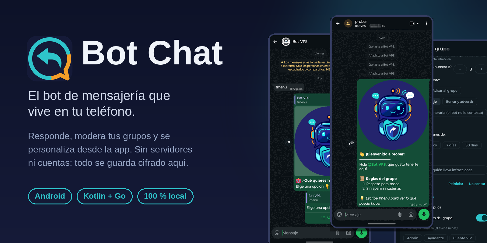
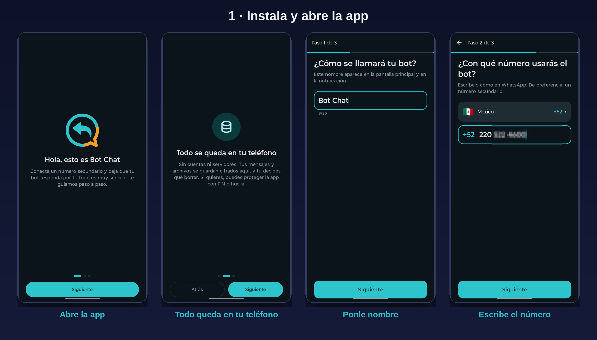
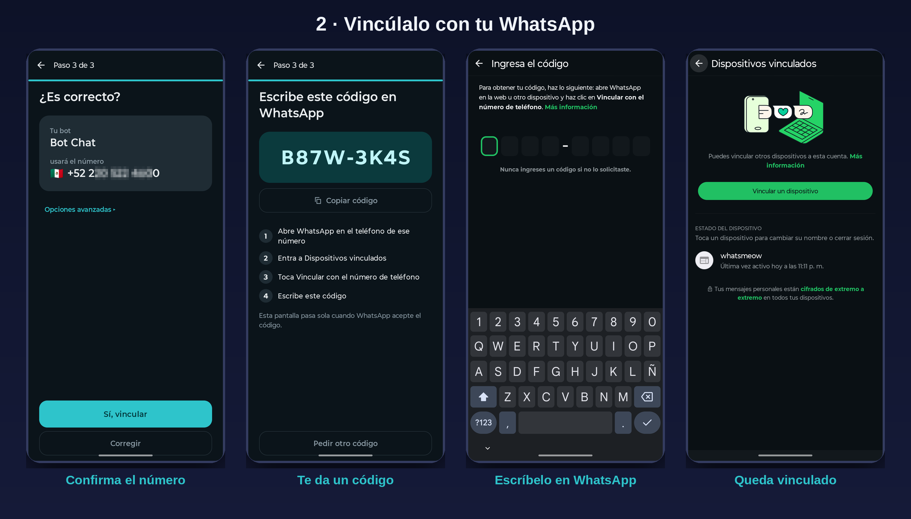
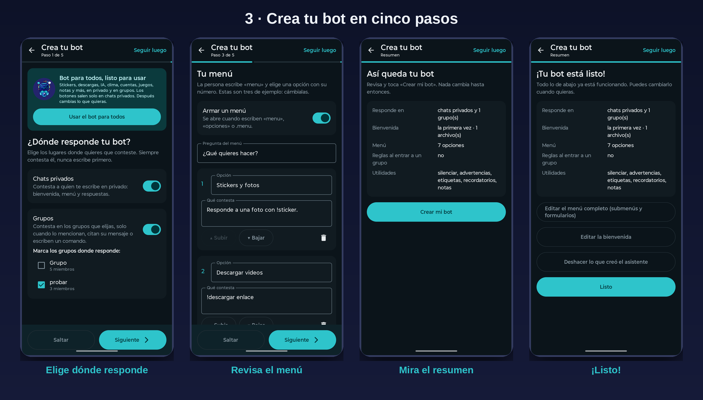
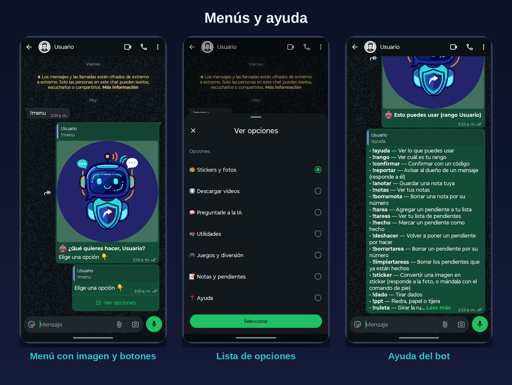
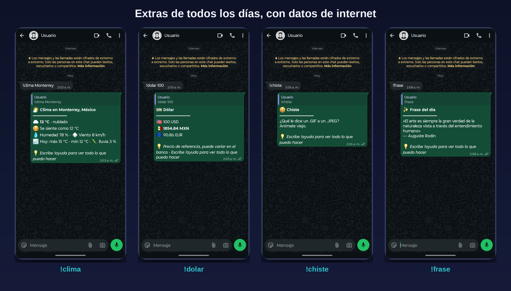
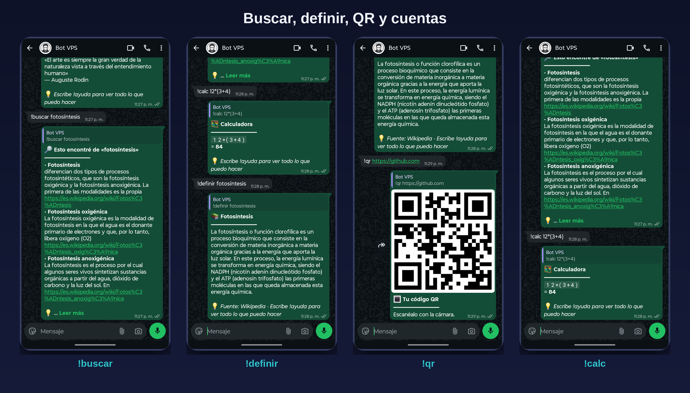
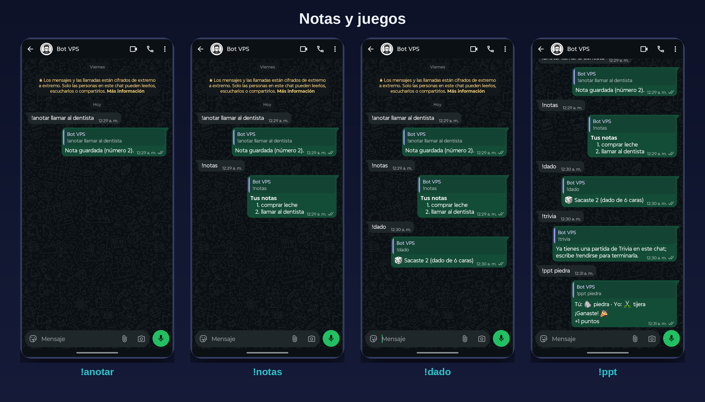
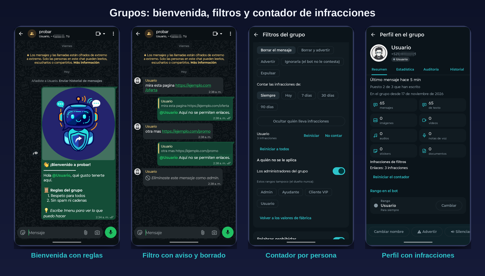
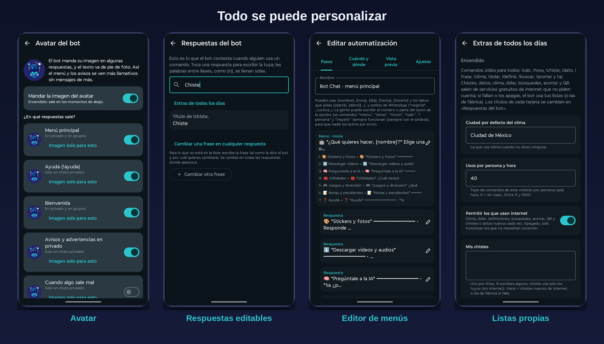

<p align="center">
  
</p>

<p align="center">
  
</p>

<h1 align="center">Bot Chat</h1>

<p align="center">
  Un bot de mensajería que vive en tu teléfono Android.<br>
  Responde, da la bienvenida, modera tus grupos y se personaliza por completo desde la app.
</p>

<p align="center">
  
  
  
  
  
</p>

---

## Qué hace

| | |
|---|---|
| **Menús con imagen y botones** | Un menú de bienvenida con la imagen del bot, botones en privado y opciones numeradas en grupos. |
| **Extras de todos los días** | `!clima`, `!dolar`, `!hora`, `!chiste`, `!dato`, `!frase`, `!buscar`, `!definir`, `!acortar`, `!qr`, `!calc`. Datos de servicios gratuitos de internet, sin cuentas ni llaves. |
| **Notas y juegos** | `!anotar`, `!notas`, `!tarea`, `!dado`, `!ppt`, `!trivia`, `!ruleta`, tres en raya y marcador. |
| **Stickers y descargas** | Convierte una foto en sticker y baja videos o audios con `!descargar` y `!audio`. |
| **Grupos** | Bienvenida con reglas, filtros (enlaces, palabras, repetidos, flood, stickers, audios, reenviados), advertencias, silencios, baneos y horario de cierre. |
| **Contador de infracciones** | Cada filtro cuenta lo que lleva cada persona, puede cambiar de acción cuando repite y se reinicia cuando quieras. |
| **Todo editable** | Menús, respuestas, títulos de cada tarjeta, listas de palabras (hasta miles), imágenes del avatar y rangos con permisos. |
| **Sin límites** | De fábrica el bot manda cuando quiera: sin topes por hora ni por día, sin pausa nocturna y sin esperas. Si prefieres frenarlo, se activan en *Límites e iniciativa*. |
| **Privado por diseño** | Sin servidores propios. Los mensajes y archivos se guardan cifrados (AES-256-GCM) en el teléfono. |

## Instalación

Necesitas un teléfono Android 8 o superior y un número de teléfono para el bot (de preferencia uno secundario).

1. **Instala el APK** de la sección *Releases* y ábrelo.
2. **Acepta los términos**, ponle nombre a tu bot y escribe su número.
3. **Vincúlalo:** la app te da un código de 8 caracteres. En el WhatsApp de ese número abre *Dispositivos vinculados → Vincular con el número de teléfono* y escribe el código.
4. **Crea tu bot** con el asistente de cinco pasos o toca **Usar el bot para todos** para dejarlo listo de un golpe.

<p align="center"></p>
<p align="center"></p>
<p align="center"></p>

## Cómo se usa

Los comandos empiezan con `!`. Escribe `!ayuda` para ver los que tu rango puede usar o `!menu` para abrir el menú.

### Menús y ayuda

<p align="center"></p>

### Extras de todos los días

<p align="center"></p>
<p align="center"></p>

### Notas y juegos

<p align="center"></p>

### Grupos

La bienvenida llega con la imagen del bot y las reglas del grupo. Cada filtro avisa, borra, advierte, ignora o expulsa, y puede cambiar de acción desde la infracción que elijas. El perfil de cada persona muestra lo que lleva.

<p align="center"></p>

### Personalízalo

<p align="center"></p>

- **Avatar del bot:** elige en qué respuestas sale su imagen y pon una distinta para cada momento.
- **Respuestas del bot:** cambia cualquier texto o título; con «Volver a fábrica» regresa al original.
- **Menús:** opciones, submenús, imágenes y archivos de cada paso.
- **Listas propias:** tus chistes, datos y frases, o miles de palabras prohibidas pegadas de una vez.
- **Rangos:** decide quién puede usar qué, por chat privado o por grupo.

## Comandos principales

| Área | Comandos |
|---|---|
| General | `!ayuda` `!menu` `!rango` `!reportar` |
| Extras | `!clima` `!dolar` `!hora` `!chiste` `!dato` `!frase` `!buscar` `!definir` `!acortar` `!qr` `!calc` |
| Notas | `!anotar` `!notas` `!borrarnota` `!tarea` `!tareas` `!hecho` `!borrartarea` |
| Juegos | `!juegos` `!dado` `!ppt` `!trivia` `!ruleta` `!adivina` `!tresenraya` `!marcador` |
| Descargas | `!descargar` `!audio` `!sticker` |
| Grupos | `!reglas` `!admins` `!todos` `!ranking` `!inactivos` `!filtros` `!infracciones` `!silenciar` `!advertir` `!expulsar` `!cerrar` `!abrir` |

Cada comando se puede dar o quitar por rango, y el prefijo se puede cambiar.

## Privacidad

- No hay cuentas, análisis ni publicidad, y no se usan servicios de Google.
- Todo se guarda en el teléfono: mensajes y archivos cifrados con AES-256-GCM y la llave en el Keystore de Android.
- Bloqueo opcional con PIN o huella y opción para evitar capturas de pantalla.
- Solo salen del teléfono las consultas que pides (clima, búsquedas, IA o traductor), hacia el servicio que elijas.

## Cómo compilar

Requisitos: JDK 17, Android SDK (plataforma 37 y build-tools), Go y `gomobile`.

```bash
# 1. Módulo Go → biblioteca para Android (genera app/libs/wabot.aar)
cd go
gomobile bind -target=android/arm64 -androidapi 26 -trimpath -ldflags="-s -w" -o ../app/libs/wabot.aar ./wabot
go test ./...

# 2. Pruebas y APK
cd ..
./gradlew testDebugUnitTest
./gradlew assembleDebug   # app/build/outputs/apk/debug/app-debug.apk
```

Solo arm64. El APK de depuración se firma con tu propia llave: para actualizar encima de una instalación previa hay que usar siempre la misma.

## Estructura

```
go/                 motor en Go: conexión, almacén cifrado, comandos, módulos y filtros
app/                aplicación Android (Kotlin, Jetpack Compose y Material 3)
docs/img/           imágenes de este README
pruebas_cruzadas/   archivos cifrados que Go y Kotlin deben leer igual
CLAUDE.md           notas de diseño, formato de cifrado y decisiones
```

## Licencia

Bot Chat es software libre bajo la licencia [GNU GPL-3.0](LICENSE). Puedes usarlo, estudiarlo, modificarlo y compartirlo; si distribuyes una versión modificada, debe seguir siendo libre con la misma licencia.

Copyright (C) 2026 Char404NF

---

<p align="center">
  <sub>Proyecto independiente, sin relación con WhatsApp ni con Meta. Software libre bajo GPL-3.0.</sub>
</p>
